# updiff

**See what a macOS app update actually changed: in the app, not in the changelog.**


[](https://github.com/intincrab/updiff/actions/workflows/ci.yml)

<p align="center">
  
</p>

Release notes say "bug fixes and improvements". The update itself might ask for your
camera, register something that starts at login, ship a new helper that runs as root,
bundle a new analytics package, or start talking to a new service. updiff takes a
snapshot of each app and, after every update, shows you exactly what changed inside it.

It also covers what updates without asking: **browser and editor extensions**, and
**installer packages** you're about to run.

- **Read-only.** It never runs the app, an installer or its scripts, and never changes them.
- **Local.** Snapshots and reports stay in `~/.updiff`. Nothing is uploaded. Only `fetch`
  downloads anything, and Gatekeeper may ask Apple whether an app is notarized.
- **Fast.** The first snapshot of 28 apps takes about 40 s on an Apple Silicon Mac (11 s
  with `--no-gatekeeper`); later checks skip unchanged apps and take about 0.1 s.

## What it looks like

A real update, Google Chrome 154 → 156, checked with `--deep`:

```text
$ updiff check --deep
Google Chrome  154.0.8037.58 (8037.58) → 156.0.8078.80 (8078.80)
com.google.Chrome
0 high · 2 notable · 6 info

NOTABLE
  + New domain chromestorage.goog
      chromestorage.goog
      at Contents/Frameworks/Google Chrome Framework.framework/Versions/156.0.8078.80/Google Chrome Framework
  + New domain perplexity.ai
      frontend-cdn.perplexity.ai, suggest.perplexity.ai, www.perplexity.ai
      at Contents/Frameworks/Google Chrome Framework.framework/Versions/156.0.8078.80/Google Chrome Framework

INFO
  ~ Google Chrome Framework.framework 154.0.8037.58 → 156.0.8078.80
  + New host under chromium.org
      g-issues.chromium.org
  + New host under google.com
      groups.google.com
  + New host under googleapis.com
      federatedcompute-pa.googleapis.com
  …

Report: ~/.updiff/reports/com.google.Chrome/…__154.0.8037.58__to__156.0.8078.80.md
```

A quiet update looks like that. A worrying one looks like this. This is the "update" the
test suite builds, trimmed:

```text
Fixture  1.0.0 (100) → 2.0.0 (200)
com.example.updiff-fixture
6 high · 6 notable · 2 info

HIGH
  - App dropped the hardened runtime
  - Helper app Fixture Helper.app dropped the hardened runtime
  + Can now ask for access to Camera
      NSCameraUsageDescription: “Fixture can now see you.”
  + App can now use the camera
      com.apple.security.device.camera = true
  + New background agent: com.example.updiff-fixture.agent.plist
      label com.example.updiff-fixture.agent · runs Contents/MacOS/Fixture · starts at login · kept alive
  + New login item: FixtureLauncher.app

NOTABLE
  + New native Node module: fastnative.node
  + Opens fixture-auth:// links
  ~ Electron 33.2.0 → 35.1.0
  + 1 new bundled npm package
      ai-plugin@0.3.0
  + New domain newvendor.io
      native.newvendor.io, telemetry.newvendor.io
      at …/fastnative.node, Contents/Resources/app.asar:dist/ai.js
  …
```

`+` added, `-` removed, `~` changed. In a terminal, high findings are red, notable
findings yellow and info cyan.

## Install

With Homebrew:

```bash
brew install intincrab/tap/updiff
```

With npm, or without installing at all (macOS, Node.js 20 or newer). npm doesn't allow
the plain name `updiff` (it is too close to the existing `diff` package), so the package
lives under the `@intincrab` scope; the command is still `updiff`:

```bash
npm install -g @intincrab/updiff
```

```bash
npx @intincrab/updiff scan Slack
```

From source:

```bash
git clone https://github.com/intincrab/updiff.git
cd updiff
npm install && npm run build && npm link
```

## Quick start

Take a baseline of every app, then check after updates:

```bash
updiff snapshot          # once, before the next round of updates
updiff check             # after updating: shows what changed in each updated app
```

Or let it check by itself:

```bash
updiff agent install     # runs `updiff check` whenever your app folders change
```

The agent waits until an update has finished writing, then posts a notification titled
"Updiff: Google Chrome 156.0.8078.80" that says "0 high, 2 notable changes". The full
report is saved in `~/.updiff/reports/`. It also checks your browser and editor extensions.

No baseline yet? Compare an installed app with its previous release, downloaded from
Homebrew's history and checked against the checksum Homebrew recorded:

```bash
updiff fetch Ghostty     # Ghostty 1.3.0 → 1.3.1: 0 high · 0 notable · 2 info
```

Before running an installer, see what it would do:

```bash
updiff pkg ~/Downloads/Installer.pkg
```

And see what your extensions can reach, or what changed since last time:

```bash
updiff extensions
updiff extensions check
```

## Commands

| Command | What it does |
|---|---|
| `updiff scan <app>` | Summarise one app: signing, sandbox, entitlements, privacy prompts, nested code, background items, Electron and hostnames. Stores nothing. |
| `updiff snapshot [app…]` | Store a snapshot of each app, or of every app when none are named. Unchanged apps are skipped. |
| `updiff check` | Snapshot every app that changed since its last snapshot and print what's different. Reports are saved as Markdown. |
| `updiff diff <app>` | If the installed app changed since its newest snapshot, compare the two; otherwise compare its two newest snapshots. |
| `updiff diff <a> <b>` | Compare any two things: `.app` bundles, snapshot `.json` files or stored apps. Good for a downloaded beta against the installed version. |
| `updiff list [app]` | List stored apps, or one app's snapshots. |
| `updiff fetch <app> [version]` | Download an earlier release from the app's Homebrew cask history, verify it against the checksum Homebrew pinned, store it as a snapshot and compare it with the installed app. With no version, the release before the installed one. `--list` shows the history. |
| `updiff pkg <installer.pkg> [older.pkg]` | Show what an installer package would do before you run it: scripts with their text, installer JavaScript, apps, launch daemons and agents (including ones apps register from inside their bundle), privileged helpers, system extensions, everything written outside /Applications, signature and Gatekeeper's verdict. With two packages, what changed. Nothing is installed or run. |
| `updiff extensions [check]` | List browser and editor extensions with what they can reach. `check` reports what changed since the last check. |
| `updiff agent install \| uninstall \| status` | Manage the LaunchAgent that runs `check` after updates. |

`<app>` can be a path (`/Applications/Slack.app`), a name from your Applications folders
(`Slack`, `"Google Chrome"`) or a stored bundle id (`com.tinyspeck.slackmacgap`).

## Options

| Option | Applies to | Effect |
|---|---|---|
| `--format text\|md\|json` | all | Output format. JSON is for scripts. |
| `--min-severity high\|notable\|info` | `diff`, `check` | Hide less important findings. |
| `--out <file>` | `scan`, `diff` | Write the result to a file. |
| `--deep` | scanning | Also search framework binaries for hostnames. Needed for apps like Chrome that keep their code in a framework. |
| `--full` | text output | Don't shorten long details. |
| `--force` | `snapshot` | Store a snapshot even if nothing changed. |
| `--apps-dir <dir>` | all | Where to look for apps. Repeatable; the default is `/Applications` and `~/Applications`. |
| `--home <dir>` | all | Data folder. Default `~/.updiff`, or `$UPDIFF_HOME`. |
| `--keep <n>` | `snapshot`, `check` | Snapshots kept per app (default 10). |
| `--notify` | `check` | Post a notification for each updated app. |
| `--extensions` | `check` | Also check browser and editor extensions (the agent does). |
| `--no-gatekeeper` | scanning | Skip the Gatekeeper/notarization check (faster). |
| `--cask <name>` | `fetch` | The Homebrew cask, when it isn't the app's name. |
| `--list` | `fetch` | List the releases in the cask's history. |
| `--settle <seconds>` | `check` | Wait until no app has changed for this long before scanning. |
| `--quiet`, `--no-color` | all | Print less; plain text. `NO_COLOR` is respected too. |
| `--interval <seconds>` | `agent install` | Fallback timer between checks (default 21600, i.e. 6 hours). |
| `--dry-run` | `agent install` | Print the LaunchAgent without installing it. |
| `--no-load` | `agent install`, `agent uninstall` | Write or remove the file but don't call `launchctl`. |

Exit codes: `0` success, `2` usage error (unknown app, bad option), `1` unexpected error.

## What it checks

| | High | Notable | Info |
|---|---|---|---|
| **Signing** | different developer team; no longer developer-signed; hardened runtime removed; no longer notarized; Gatekeeper rejects it or can't verify its signature | signing certificate changed; distribution changed (Developer ID ↔ App Store) | hardened runtime added; notarization ticket stapled or unstapled |
| **Entitlements**, for every executable in the bundle | camera, microphone, location, contacts, calendars, photos, Apple Events, USB, Bluetooth, library validation off, debugging, Endpoint Security, network extensions, sandbox exceptions; sandbox removed | any other new entitlement; new values in app groups, keychain groups or associated domains | removals |
| **Privacy prompts** (`NS…UsageDescription`) | a new prompt | | reworded or removed prompts |
| **Background** | new LaunchAgent or LaunchDaemon, login item, privileged helper, system extension | changed background item | removals |
| **Updater** (Sparkle) | update feed moved; update signing key changed | feed added or removed; feed set in the code changed | |
| **Network** | App Transport Security allows plain HTTP | new ATS exception domains | |
| **Code** | | new helper apps, XPC services, app extensions, plug-ins, executables, native Node modules, frameworks | framework versions; removals |
| **Electron** | | Electron version; new bundled npm packages | package version changes and removals |
| **Hostnames** | | new domains | new hosts under domains already present; domains no longer mentioned |
| **URL schemes** | | new `scheme://` handlers | removals |
| **Identity** | the two sides are different apps | Dock icon shown or hidden; moved to or from the Mac App Store | version, minimum macOS, size |
| **Browser extensions** | access to all websites; sensitive APIs (cookies, history, webRequest, debugger, nativeMessaging, proxy…); a different update server; a new extension with access to all websites | other new permissions; access to specific new sites; a new extension | low-reach permissions (storage, alarms…); optional permissions; removals; versions |
| **Editor extensions** (VS Code, Cursor, Windsurf, VSCodium) | starts installing other extensions | now starts with every window; new npm packages; new native code; new domains in the code; a new extension | removals; versions |

Gatekeeper's verdict comes from `spctl`, which may contact Apple for apps without a
stapled notarization ticket. Sparkle feeds are read from `Info.plist` and, for apps that
set them in code (Ghostty, ChatGPT), from URLs in the binary; `scan` also shows this Mac's
update settings for the app. Binaries that are FairPlay-encrypted (iPhone and iPad apps)
are flagged, because their strings can't be read. Mac App Store apps for macOS are not
encrypted, so their hostnames are read like any other app's.

Code inside a bundle is matched between versions by its path and, if that fails, by its
bundle id. So a renamed helper isn't reported as removed plus added, and Chrome's
`Versions/154…` → `Versions/156…` framework folders count as the same thing.

## About hostnames

updiff finds hostnames in URLs (`https://`, `wss://`, …) and in quoted strings like
`"events.vendor.io"`. It looks in executables, native modules, Electron `app.asar`
archives and text resources, and reports them grouped by domain.

> **A hostname in the code is not proof that the app connects to it.** It shows what the
> code mentions: API endpoints, links, sometimes dead code. Treat a new domain as a lead
> and confirm it with a network monitor such as Little Snitch or LuLu.

To keep reports readable, it ignores:
- source maps, READMEs, licences and the `package.json` files inside `node_modules`
- XML namespaces and reserved names (`www.w3.org`, `example.com`, `localhost`, `*.test`)
- bare strings whose ending reads like a file type (`Foo.app`, `README.md`, `build.sh`)
- any file with more than 1,000 bare hostnames, which is a bundled list rather than code
  (Discord's main bundle carries one with about 6,100 entries). These are named in a
  warning.

Framework binaries are only searched with `--deep`. Electron apps keep their own code in
`app.asar`, which is always searched.

## Where things are stored

```text
~/.updiff/
├── snapshots/<bundle id>/<time>__<version>__<build>.json   one JSON file per snapshot
├── reports/<bundle id>/<time>__<from>__to__<to>.md         one report per detected update
├── extensions/<time>.json                                  installed extensions (last 10)
├── reports/extensions/<time>__<from>__to__<to>.md          one report per extension change
└── agent.log                                               output of background checks
```

A snapshot records a fingerprint of the app's code signature seal
(`_CodeSignature/CodeResources`), so an unchanged app is recognised without a rescan.
Delete the folder at any time to start over.

## Privacy and safety

- updiff reads files and runs Apple's own tools:
  - `plutil` and `defaults` to read plists and an app's update settings
  - `codesign`, `spctl` and `stapler` to read signatures, Gatekeeper's verdict and
    notarization tickets
  - `hdiutil` (read-only) and `pkgutil --expand-full` to open disk images and packages
  - `osascript` for notifications, `launchctl` for the agent
- It never runs app code, installer scripts or installer JavaScript.
- Nothing it records leaves your Mac. `fetch` downloads from Homebrew, GitHub and the
  app's vendor; `spctl` may ask Apple about notarization. Nothing else uses the network.
- The agent is a LaunchAgent in your user account (`dev.updiff.check`). It runs with your
  permissions, at low priority. `updiff agent install --dry-run` shows exactly what it
  installs; `updiff agent uninstall` removes it.

## Limitations

- **Static only.** Plugins, models or config that an app downloads after launch aren't in
  the bundle, so updiff can't see them.
- **Hostnames are pattern-matched.** Hosts assembled at runtime (`"api." + region + ".x.com"`)
  are missed, and a mentioned host is not necessarily contacted.
- **Baselines.** `check` compares with the last snapshot. For an app you never snapshotted,
  `updiff fetch` gets its previous release, if the app is in Homebrew.
- **Update feeds built at runtime** (AltTab assembles its URL from pieces) can't be found;
  `scan` says when Sparkle is bundled but no feed was found.
- **Not covered yet:** Safari web extensions' permissions, managed browser policies, and
  extensions for JetBrains IDEs.

## The ledger

[`ledger/`](ledger) runs updiff every day on new releases of about 30 popular Mac apps
(Slack, Zoom, Cursor, VS Code, Postman, Chrome, Discord, …), found through their
Homebrew casks. It publishes what changed in each release as a static site with an Atom
feed. Reports are plain JSON in [`ledger/data`](ledger/data). See
[ledger/README.md](ledger/README.md) to run it or turn on the daily GitHub Action.

## How it works

Every scan, a few steps:
1. Read `Info.plist` with `plutil`.
2. Walk the bundle without following symlinks, and skip framework versions that
   `Versions/Current` doesn't point to.
3. Classify nested code by type and location.
4. Read each item's signature and entitlements with `codesign`.
5. Read `app.asar` with a built-in parser, without extracting it.
6. Search text and the arm64 slice of each binary for hostnames.

The diff compares two snapshots and assigns each change a severity. The full design and
the reasoning behind the rules are in [docs/DESIGN.md](docs/DESIGN.md).

## Development

```bash
npm install
npm test                    # unit + integration tests
npm run typecheck
npm run build               # compiles to dist/
npm start -- scan Ghostty   # run from source (Node 22.18+ runs the TypeScript directly)

# re-record the README demo: a real run against a generated demo app, rendered to docs/demo.svg
node scripts/demo/record.ts && node scripts/demo/render-svg.ts
```

The integration tests build two versions of a small Electron-style app with clang,
`@electron/asar` and `codesign`. They plant permission, background, package and network
changes, then check that each one is reported at the right severity, both through the
library and through the commands. Without a C compiler, the assertions about hostnames
inside binaries are skipped.

CI runs all of this on a macOS runner for every push, then installs the packed tarball
and runs it on Node 20, 22 and 24.

### Releasing

Bump the version in `package.json` and `src/version.ts` (a test checks they match),
commit, and push a matching tag:

```bash
git tag v0.2.0 && git push origin v0.2.0
```

The [release workflow](.github/workflows/release.yml) tests and packs updiff, creates a
GitHub Release with the tarball, and publishes it to npm with provenance. The
[Homebrew tap](https://github.com/intincrab/homebrew-tap) picks up the new release within
a few hours, or straight away if you run its workflow by hand.

## License

[MIT](LICENSE)
